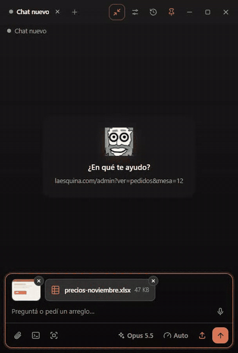

# Marito

Una ventana flotante de Claude para Windows. Apretás un atajo sobre lo que tenés adelante (una página, VS Code, una
carpeta, cualquier programa) y le preguntás o le pedís un cambio: Marito mira la pantalla, reconoce el proyecto y corre
**Claude Code** en esa carpeta. Si le pedís un arreglo en una web tuya, lo hace, lo publica y sigue el deploy.

*A floating Claude window for Windows: press a hotkey over whatever you're looking at and ask or request a change.
It runs Claude Code locally on the project it recognizes. The interface is in Spanish.*

| Atajo | Qué abre |
|---|---|
| **Alt+F1** | La ventana al costado |
| **Alt+F2** | La barra de una línea, arriba |
| **Alt+F3** | Marcar una zona de la pantalla y preguntar por eso |

## Instalar

1. Bajá **`Marito-Setup-x.y.z.exe`** de [Releases](../../releases/latest) y abrilo. Se instala para tu usuario, sin
   pedir administrador. El instalador no está firmado: si Windows muestra «Windows protegió tu PC», tocá
   **Más información → Ejecutar de todas formas**.
2. Marito necesita **Claude Code** con tu cuenta (Pro, Max, Team, Enterprise o API key). Si no lo tenés, Marito te
   ofrece instalarlo con el instalador oficial; después corré `claude` una vez en una terminal para iniciar sesión.
3. Listo: el ícono de Marito queda en la bandeja y los atajos andan en cualquier programa.

Qué cambió en cada versión: [CHANGELOG.md](CHANGELOG.md).

### Qué necesita la PC

- Windows 10 u 11 de 64 bits. Lo demás viene con Windows o lo trae el instalador (Node.js, y WebView2 si falta).
- Anda bien en PCs comunes: la ventana y el servidor local usan poca memoria; Claude corre en la nube.
- **Opcional**: `git` y `gh` (GitHub CLI) para que Marito publique tus cambios; la **voz y el dictado** (~1,5 GB, corren
  en el procesador) se instalan desde el menú del ícono. En una PC lenta, la voz tarda más en contestar.

## Antes de usarlo

- Marito corre Claude Code con los **permisos automáticos** (`--permission-mode auto`): en un proyecto puede leer y
  cambiar archivos y hacer commits; en el «Chat libre», leer y escribir en toda la PC. Antes de publicar (push) pregunta.
  Si tu organización apagó el modo automático, Claude arranca en modo manual y no va a poder hacer cambios.
- Lo que hace se cuenta en tu plan de Claude. Las capturas de pantalla van a Claude solo cuando las pedís o marcás.
- Tus datos (configuración, historial, registros) quedan en `%LOCALAPPDATA%\arreglo`; desinstalar Marito no los borra.

## Cómo se usa

### La barra (Alt+F2)
Una línea arriba de la pantalla, sobre lo que estás mirando. Escribís y Enter; la respuesta aparece en una tarjeta
debajo, con lo que Claude va haciendo. **Continuar →** (o ⤢, o Alt+F1) pasa la charla a la ventana del costado.
Se mueve desde los seis puntitos de la izquierda (o dejándola apretada en cualquier lado), se estira desde los
costados y **Esc** la cierra. Un toque en la rayita de abajo de la tarjeta la esconde para ver la pantalla.

### La ventana (Alt+F1)
La charla completa, al costado: pestañas (cada una es una conversación y corren a la vez), historial, modelo y
esfuerzo, archivos (el clip, arrastrarlos o Ctrl+V), y una terminal (**>_** o Ctrl+`) que corre PowerShell en la carpeta
del proyecto. En los deslizadores de arriba: la carpeta de tus proyectos, cómo se ve la ventana y la voz.

### Marcar una zona (Alt+F3)
La pantalla se congela y arrastrás un rectángulo: la pregunta que hagas es sobre eso. Esc o el botón derecho cancelan.
También sirve copiar una imagen (por ejemplo con Win+Shift+S) y abrir Marito en menos de 2 minutos: la adjunta sola.

### Te muestra dónde tocar
Preguntá «¿cómo exporto esto?» o «guiame para cambiar el idioma» con el programa adelante: Marito mira la pantalla y
dibuja un **recuadro naranja** sobre lo que hay que tocar, con una línea desde la ventana. Lo tocás y marca solo el paso
siguiente. Con el mouse encima del cartel ves para qué sirve y qué va a pasar, y el botón **Salir del tutorial**.
- Si el botón está más abajo, el paso es bajar con la ruedita: una flecha marca dónde, y cuando aparece, lo marca.
- Si tocás y no pasa nada, Marito se da cuenta y Claude mira de nuevo.
- En la lista del chat, cada paso tiene **▶ desde acá** para volver a ese paso.
- Si después preguntás «¿por qué falla?» o «¿qué pasó?», contesta por lo que hay en la pantalla en ese momento.

### Proyectos y publicar
Si lo que tenés adelante es de un proyecto tuyo (la web en el navegador, la carpeta en VS Code o en el Explorador),
Claude trabaja en esa carpeta. Si le pedís un cambio, lo hace y lo commitea; después Marito hace el push y sigue el
deploy (los checks de GitHub) hasta que está publicado. Antes de publicar pregunta si la rama no es la esperada o si
salen commits que no son de este pedido. Las casillas **Commitear** y **Push automático** (al lado del esfuerzo) lo
apagan. Sin proyecto, es el **Chat libre**: Claude trabaja en tu carpeta de usuario y no publica nada.

### Voz (opcional)
**Ctrl+M** dicta (escribe lo que decís, no lo manda) y **Ctrl+Shift+M** es la charla por voz (te contesta hablando).
La voz se instala desde el menú del ícono y se elige en los deslizadores; de entrada Marito no habla.

### Atajos

| Atajo | Qué hace |
|---|---|
| Alt+F1 · Alt+F2 · Alt+F3 | La ventana · la barra · marcar una zona (en cualquier programa) |
| Enter · Shift+Enter | Mandar · salto de línea (con Claude trabajando, el mensaje queda en cola) |
| Esc | Corta lo que está haciendo Claude; si no hace nada, esconde la ventana o cierra la barra. Corta el dictado |
| Ctrl+T o Ctrl+N · Ctrl+W | Pestaña nueva · cerrarla |
| Ctrl+Tab · Ctrl+1…9 | Cambiar de pestaña |
| Ctrl+` | La terminal |
| Ctrl+M · Ctrl+Shift+M | Dictar · charla por voz |
| F11 | Pantalla completa |

## Problemas comunes

- **«Windows protegió tu PC»** al instalar: el instalador no está firmado todavía. **Más información → Ejecutar de
  todas formas**.
- **Un atajo no anda**: otro programa ya lo usa (Marito lo avisa al arrancar). Abrí Marito desde el menú del ícono de
  la bandeja, o cerrá el otro programa y reiniciá Marito (menú → Salir, y abrirlo de nuevo).
- **No encuentra Claude Code**: Marito lo busca donde lo deja el instalador oficial (`%USERPROFILE%\.local\bin`), en
  `%APPDATA%\npm` y en el PATH. Si está instalado pero no contesta, corré `claude` una vez en una terminal para iniciar
  sesión.
- **Claude explica pero no cambia nada**: tu organización apagó el modo de permisos automático de Claude Code.
- **No publica**: hacen falta `git` y `gh` con sesión (`gh auth login`) y un remoto `origin`. Sin eso, el cambio queda
  commiteado en tu PC.
- **El recuadro no aparece o cae mal**: Windows no deja leer los controles de un programa abierto como administrador
  desde uno común; Marito usa entonces lo que lee en la captura, que es menos preciso. Si no está seguro, te dice qué
  buscar en vez de marcar.
- **La ventana queda en blanco**: falta o se rompió WebView2. Instalá el «Evergreen Runtime» de Microsoft y abrí
  Marito de nuevo.
- **Para reportar un error**: los registros están en `%LOCALAPPDATA%\arreglo` (`lanzador.log` y una carpeta por vez que
  se abrió). Mirá que no tengan nada privado antes de adjuntarlos a un issue.

## Por ahora, solo con Claude Code

Marito habla con `claude -p --output-format stream-json`. Otras IAs con CLI que edite archivos (Codex CLI, Gemini CLI)
se pueden sumar con un adaptador en `servidor/turnos.mjs`: los PR son bienvenidos.

## Desarrollar

- Sin instalar: `powershell -ExecutionPolicy Bypass -File abrir.ps1` (necesita Node 20+ en el PATH). La interfaz sola, sin
  servidor: abrí `ui/index.html?demo` desde el servidor.
- Pruebas: `npm test`. Cómo está armado: [`ESPEC.md`](ESPEC.md).
- Instalador: `instalador/armar.ps1 -Version 0.1.0` con Inno Setup 6. GitHub Actions lo arma y lo publica en cada tag `v*`.

## Privacidad / Privacy

Marito no manda nada a ningún servidor por su cuenta: no tiene telemetría ni cuenta propia. Lo que pedís lo procesa
Claude Code con tu cuenta de Claude (según la [política de privacidad de Anthropic](https://www.anthropic.com/legal/privacy)),
y solo descarga algo cuando lo pedís (Claude Code, la voz) o cuando falta WebView2 al instalar.

*This program will not transfer any information to other networked systems unless specifically requested by the user
or the person installing or operating it.*

## Code signing policy

Free code signing provided by [SignPath.io](https://about.signpath.io), certificate by
[SignPath Foundation](https://signpath.org) *(applied for; until it is approved, releases are unsigned)*.

- Signed files: `Marito-Setup-x.y.z.exe` and `Marito.exe`, built from this repository by
  [GitHub Actions](.github/workflows) on GitHub-hosted runners for each `v*` tag. Bundled third-party binaries
  (Node.js, WebView2 DLLs) keep their own upstream signatures.
- Committers and reviewers: [valedominguezl](https://github.com/valedominguezl). Pull requests from anyone else are
  reviewed before merging.
- Approvers: [valedominguezl](https://github.com/valedominguezl). Every signing request is approved by hand.
- Uninstall: from Windows Settings → Apps → Marito (the installer includes an uninstaller).

## Licencia

[MIT](LICENSE)
